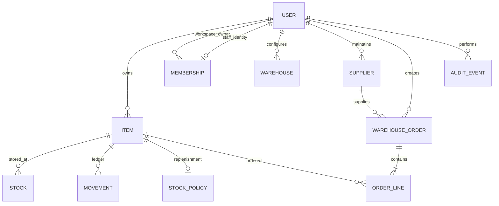
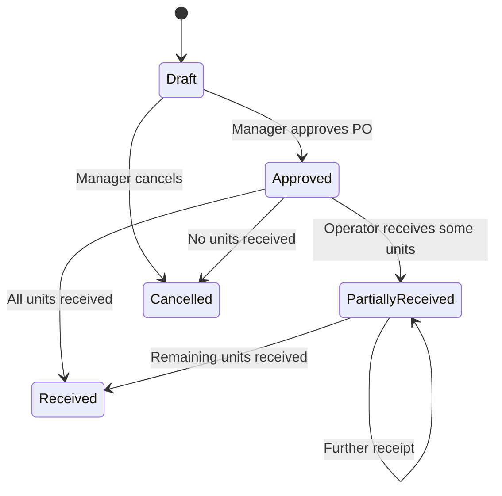
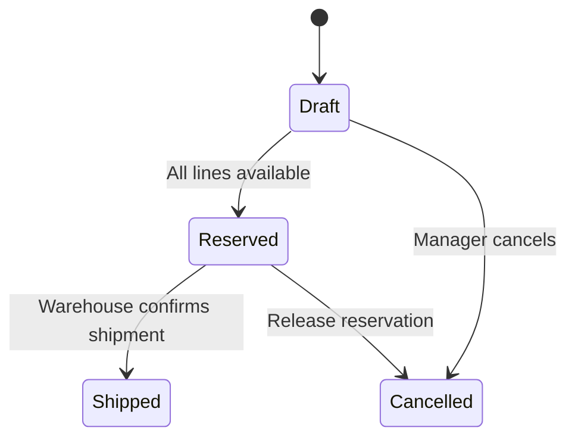

# Architecture and design evidence

## Application layers

```mermaid
flowchart LR
    Browser[HTML / CSS / JavaScript] --> Routes[Flask routes and CSRF checks]
    Routes --> Access[Workspace ownership and role checks]
    Access --> Commands[Replay guard and audit transaction]
    Commands --> Services[Receipt / reservation / shipment services]
    Services --> DB[(SQLite / SQLAlchemy)]
    DB --> Models[Daily demand aggregation]
    Models --> Validation[Rolling-origin model comparison]
    Validation --> Plan[Replenishment plan]
    Plan --> Draft[Manager-reviewed purchase draft]
```

## Entity relationships

Stock locations are immutable string labels retained for compatibility with the original extension. They are validated against the workspace warehouse directory; there is no database foreign key from Stock.location to Warehouse.label. Warehouse rename/delete is deliberately absent to avoid invalidating historical records.

## State machines

## Transaction invariants

1. Physical stock never becomes negative (database check plus conditional write).
2. Reservations do not change physical stock.
3. Available stock = physical stock minus Reserved sales-order lines at the same location.
4. Transfers preserve the product total across locations.
5. Every enterprise command, its audit event, order status and stock/ledger effects commit together.
6. An invalid line rolls back all earlier line changes in the same command.
7. A unique workspace/request key prevents replaying a successful enterprise form.
8. Ownership is derived from the authenticated user’s membership; callers cannot choose workspace IDs in forms.

The reservation query uses a conditional Stock update with a correlated reservation total. Enterprise commands first flush an audit event to acquire SQLite’s writer lock; concurrent transactions serialize before reading order states and posting stock. The concurrency test requests two reservations of six units against ten available; exactly one becomes Reserved and four remain available. This evidence applies to the current SQLite implementation, not a claim of equivalent behavior on every database engine.

## Forecast validation

The last seven daily observations are used as seven rolling-origin, one-step folds. For each fold, training stops before that day. Compare absolute prediction errors for linear regression and a recent seven-day mean; the lower mean error selects the final model. Refit that model on all available daily observations and project demand. The same validation period selects and scores the model; an unbiased future assessment needs a separate test period or ongoing prospective monitoring.

ABC is a deterministic classification of inventory value, not an AI classifier. Forecasting is statistical machine learning, not a language model. The reorder buffer is a transparent planning heuristic; it is not a calibrated service-level guarantee.

## Scope and provenance

The upstream MIT project supplied user/item models, password helpers and extension structure. Warehouse balances, movement safeguards, enterprise domain tables, service layer, role checks, order state machines, idempotency, audit, forecast validation and current UI are additions. Preserve LICENSE and cite upstream in any report or redistribution.
